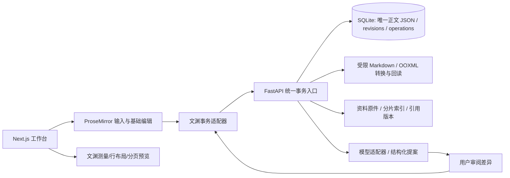

# 架构与实施顺序

原生正文为版本化 PM 兼容 JSON；HTML、Markdown、DOCX、分页结果只派生不双写。
文渊自有模块负责模型边界验证、节点身份、统一持久化事务、修订/幂等/原文校验、
布局预览、转换、AI 协议。PM 负责 contenteditable、IME、选区、粘贴及基础撤销。
首版连续编辑 + 独立分页预览；没有声称实现 Word 编辑时的完整分页。

## 逐步验收

1. 审计/来源：独立目录与 Git，迁移白名单，依赖和许可证记录。
2. 持久化闭环：身份与所有权、CRUD、revision CAS、幂等请求、操作状态、回读、历史。
3. 编辑闭环：中文富文本、表格/图片、稳定 ID、大纲、自动保存与本地恢复、冲突提示。
4. 格式/布局：测量字形与行、有限分页、Markdown/DOCX 子集、导出回读、安全上传。
5. AI/资料：真实 HTTP 模型配置、加密密钥、来源检索、结构化提案、确认/拒绝/取消。
6. 验证/交付：单元与模拟测试、浏览器流程、合成样例、依赖锁/许可证、可复现启动。

每一步的实际命令、结果和未完成验收记录在 `VALIDATION.md`；通过单测不等于真实
IME 或 Office 人工验收通过。第二阶段增加页眉页脚/页码/复杂表格/批注；第三阶段才
考虑实时协作与插件权限。Excel/PPT/复杂公式/任意 DOCX 无损均不属本期。
